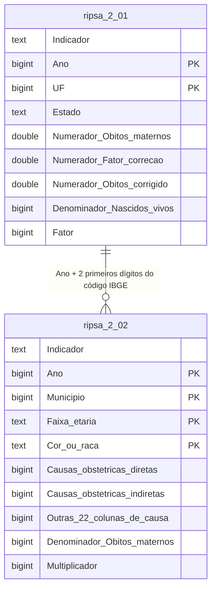

# Mortalidade Materna no Brasil: Camada de Dados

Projeto de Big Data sobre mortalidade materna no Brasil, construído a partir de dados
públicos dos indicadores **MRT.2.01** e **MRT.2.02** da RIPSA (Rede Interagencial de
Informações para a Saúde).

Esta etapa cobre a **unificação, o tratamento, a modelagem e o armazenamento** dos dados:
as bases públicas foram tratadas, versionadas no repositório e carregadas em um
PostgreSQL hospedado na nuvem, com a infraestrutura descrita como código em Terraform.

> **Anna Luiza Moreira, Murilo Moreno, Samara Parcero e Uelisson Tiago · Big Data e Analytics · T2 · Professora Sheila Tirony**

---

## Sumário

1. [Dados utilizados](#1-dados-utilizados)
2. [Tratamento realizado](#2-tratamento-realizado)
3. [Modelagem](#3-modelagem)
4. [Infraestrutura](#4-infraestrutura)
5. [Segurança das informações](#5-segurança-das-informações)
6. [Execução](#6-execução)
7. [Estrutura do repositório](#7-estrutura-do-repositório)
8. [Resumo das decisões técnicas](#8-resumo-das-decisões-técnicas)


---

## 1. Dados utilizados

### Fonte

| Item | Descrição |
|---|---|
| Produtor | RIPSA (Rede Interagencial de Informações para a Saúde) |
| Sistemas de origem | SIM (Sistema de Informações sobre Mortalidade) e SINASC (Sistema de Informações sobre Nascidos Vivos), Ministério da Saúde |
| Endereço de obtenção | **https://dadosabertos.saude.gov.br/dataset/ripsa-mortalidade-dimensao-2-mortalidade-materna** |
| Formato original | CSV, com os arquivos preservados em `dados/brutos/` |

Os arquivos originais foram mantidos no repositório **sem nenhuma alteração**, lado a lado
com as versões tratadas. Isso permite reexecutar o processo do zero e comparar entrada e
saída a qualquer momento.

### Identificação das bases

**MRT.2.01: Razão de mortalidade materna** (`dados/brutos/RIPSA mrt2.01.csv`)

Óbitos maternos e nascidos vivos agregados por unidade da federação e ano. A base traz o
numerador bruto, o fator de correção de sub-registro aplicado pelo Ministério da Saúde e o
numerador já corrigido. O indicador é calculado como:

```
Razão de mortalidade materna = (óbitos maternos corrigidos ÷ nascidos vivos) × 100.000
```

**MRT.2.02: Mortalidade materna por grupo de causas** (`dados/brutos/RIPSA mrt2.02.csv`)

Óbitos maternos desagregados por município, faixa etária, cor/raça e grupo de causa
(CID-10). Separa causas obstétricas **diretas** (hipertensão, hemorragia, infecção
puerperal, aborto, entre outras) de causas **indiretas** (doenças circulatórias,
respiratórias, infecciosas, endócrinas, entre outras), além de um grupo inespecífico. O
denominador é o total de óbitos maternos do próprio recorte, e o multiplicador 100 indica
que o indicador derivado é uma proporção percentual.

### Recorte utilizado

**2009 a 2023**, para as duas bases.

A MRT.2.01 disponibiliza a série de 2009 a 2023; a MRT.2.02 cobre de 2000 a 2024. A
interseção entre as duas é 2009–2023, e foi esse o recorte adotado, de modo que todo ano
presente em uma base exista também na outra e os dois indicadores possam ser cruzados sem
lacunas.

### Características relevantes

| Característica | MRT.2.01 | MRT.2.02 |
|---|---|---|
| Granularidade | UF × ano | Município × faixa etária × cor/raça × ano |
| Registros brutos | 405 | 32.005 |
| Registros tratados | 405 | 19.539 |
| Colunas (tratadas) | 9 | 29 |
| Período tratado | 2009–2023 | 2009–2023 |
| Cobertura | 27 UFs × 15 anos, série completa | 3.850 municípios |
| Valores ausentes | nenhum | nenhum |
| Registros duplicados | nenhum | nenhum |

A MRT.2.01 é uma série densa e completa: os 405 registros correspondem exatamente a 27 UFs
× 15 anos, sem nenhuma combinação faltante. Já a MRT.2.02 é esparsa por natureza, só
existe linha onde houve óbito materno registrado naquele município, naquela faixa etária e
naquela cor/raça, o que explica a presença de 3.850 dos 5.570 municípios brasileiros.

Categorias presentes na MRT.2.02:

- **Faixa etária**: `10 a 19 anos`, `20 a 34 anos`, `35 anos e mais`, `Não informado`
- **Cor ou raça**: `Amarela`, `Branca`, `Indígena`, `Parda`, `Preta`, `Não informado`

---

## 2. Tratamento realizado

Todo o tratamento está em [`etl/Tratativa dos Dados.ipynb`](etl/Tratativa%20dos%20Dados.ipynb),
escrito em Python com pandas. O notebook lê os arquivos de `dados/brutos/`, aplica as
transformações e grava o resultado em `dados/tratados/`.

### Problemas e características identificados

1. **Períodos divergentes entre as bases.** A MRT.2.01 cobre 2009–2023 e a MRT.2.02 cobre
   2000–2024. Cruzar as duas sem alinhar o recorte produziria anos sem contrapartida.
2. **Unidade da federação apenas como código numérico.** A MRT.2.01 identifica o estado
   somente pelo código IBGE (`11`, `12`, `13`...), ilegível em qualquer visualização.
3. **Categorias com marcação técnica da fonte.** Tanto `Cor ou raça` quanto `Faixa etária`
   trazem o valor `~Nao informado`, com til inicial e sem acentuação.
4. **Código de município sujeito a interpretação numérica.** O código IBGE é um
   identificador, não uma quantidade; lido como inteiro, aceitaria somas e médias sem
   sentido.
5. **Coluna de escala constante.** A coluna `Fator` vale 100.000 em todos os registros da
   MRT.2.01, e `Multiplicador` vale 100 em todos os da MRT.2.02.
6. **Rótulos de coluna irregulares na origem.** Os cabeçalhos chegam com acentuação
   inconsistente (`Obitos`, `correçao`, `Hipertensao`, `Infecçao`), com espaços, e um deles
   truncado pela própria fonte (`...relacionados predominantemente com a gravid`).

### Decisões tomadas e justificativas

| # | Decisão | Justificativa |
|---|---|---|
| 1 | Recortar as duas bases em **2009–2023** | Garante que os dois indicadores cubram exatamente o mesmo período, permitindo o cruzamento na fase de análise. O volume total é pequeno, então nenhuma amostragem adicional foi necessária: preservou-se toda a série histórica disponível em comum. |
| 2 | Criar a coluna **`Estado`** a partir do código IBGE | Torna a base legível sem exigir uma tabela de apoio externa. A coluna de código (`UF`) foi mantida, porque é ela que liga a MRT.2.01 à MRT.2.02. |
| 3 | Padronizar `~Nao informado` para **`Não informado`** | Alinha a categoria ao restante dos valores, que são acentuados, e evita que o mesmo conceito apareça escrito de duas formas em agrupamentos e gráficos. |
| 4 | Converter **`Municipio`** para texto no DataFrame | O código IBGE é identificador categórico. Tratá-lo como texto evita operações aritméticas indevidas e preserva a estrutura de 6 dígitos. |
| 5 | **Manter** as colunas `Fator` e `Multiplicador` | Embora constantes, documentam a escala do indicador (por 100.000 nascidos vivos e em percentual). Removê-las economizaria espaço irrelevante e exigiria que a escala fosse memorizada fora da base. |
| 6 | **Preservar** os nomes de coluna da fonte | Mantém a rastreabilidade direta entre a base publicada pela RIPSA e a base carregada, inclusive para conferência pelo avaliador. O custo é ter de usar aspas duplas nas consultas SQL, ver [Modelagem](#3-modelagem). |
| 7 | **Não** imputar nem descartar registros | A verificação não encontrou valores ausentes nem duplicatas nas chaves naturais, então nenhuma estratégia de imputação ou deduplicação foi necessária. |

### Transformações aplicadas

| Base | Transformação | Efeito |
|---|---|---|
| MRT.2.02 | Filtro `2009 ≤ Ano ≤ 2023` | 32.005 → 19.539 registros (12.466 removidos) |
| MRT.2.01 | Inserção da coluna `Estado` na posição 4 | 8 → 9 colunas |
| MRT.2.02 | `~Nao informado` → `Não informado` em `Cor ou raça` e `Faixa etária` | categorias padronizadas |
| MRT.2.02 | `Municipio` convertido para `string` | tipo categórico no DataFrame |
| Ambas | Gravação em `dados/tratados/` com `index=False` | CSVs finais, sem coluna de índice |

### Verificação do resultado

As bases tratadas foram conferidas quanto à integridade:

- `RIPSA 2.01 tratado.csv`: 405 registros, 0 nulos, 0 duplicatas, chave `(Ano, UF)` única
- `RIPSA 2.02 tratado.csv`: 19.539 registros, 0 nulos, 0 duplicatas, chave
  `(Ano, Municipio, Faixa etária, Cor ou raça)` única
- Os 27 prefixos de UF presentes nos códigos de município da MRT.2.02 correspondem
  exatamente às 27 UFs da MRT.2.01, nos dois sentidos, nenhum órfão de nenhum lado

---

## 3. Modelagem

### Estratégia adotada

As duas bases foram modeladas como **duas tabelas de fatos agregados independentes**, uma
por indicador, preservando a granularidade original de cada uma.

A alternativa considerada foi um modelo dimensional clássico, com tabelas de dimensão
separadas para tempo, município/UF, faixa etária e cor/raça. Ela foi descartada por três
razões:

1. **Os dados já chegam agregados.** A fonte não publica o microdado do óbito, e sim
   contagens por combinação de atributos. Não existe grão menor para decompor.
2. **As granularidades são diferentes.** A MRT.2.01 é por UF/ano e a MRT.2.02 é por
   município/faixa/cor/ano. Forçar as duas em um mesmo esquema estrela exigiria uma tabela
   de fatos artificial ou a perda de detalhe de uma delas.
3. **O volume não justifica a complexidade.** São 19.944 registros no total. O custo de
   manter quatro dimensões e suas chaves substitutas superaria qualquer ganho de
   desempenho ou de armazenamento.

Manter duas tabelas espelhando os indicadores deixa a camada de dados **legível,
rastreável até a fonte e imediatamente consultável** na próxima fase, que é o objetivo
desta etapa.

### Estrutura do banco

As tabelas são criadas em tempo de execução por `carregar_dados.py`, que converte os
tipos do pandas em tipos do PostgreSQL: inteiros viram `BIGINT`, decimais viram
`DOUBLE PRECISION` e o restante vira `TEXT`.

#### Tabela `ripsa_2_01`: 405 registros, 9 colunas

| # | Campo | Tipo | Descrição |
|---|---|---|---|
| 1 | `Indicador` | TEXT | Código do indicador (`MRT.2.01`) |
| 2 | `Ano` | BIGINT | Ano de referência (2009–2023) |
| 3 | `UF` | BIGINT | Código IBGE da unidade da federação |
| 4 | `Estado` | TEXT | Nome da UF, **coluna derivada no tratamento** |
| 5 | `Numerador - Obitos maternos` | DOUBLE PRECISION | Óbitos maternos registrados |
| 6 | `Numerador - Fator de correçao utilizado` | DOUBLE PRECISION | Fator de correção de sub-registro |
| 7 | `Numerador - Obitos maternos corrigido` | DOUBLE PRECISION | Óbitos após correção |
| 8 | `Denominador - Nascidos vivos` | BIGINT | Nascidos vivos no período |
| 9 | `Fator` | BIGINT | Escala do indicador (100.000) |

#### Tabela `ripsa_2_02`: 19.539 registros, 29 colunas

| # | Campo | Tipo |
|---|---|---|
| 1 | `Indicador` | TEXT |
| 2 | `Ano` | BIGINT |
| 3 | `Municipio` | BIGINT |
| 4 | `Faixa etária` | TEXT |
| 5 | `Cor ou raça` | TEXT |
| 6 | `Numerador - Causas obstétricas diretas` | BIGINT |
| 7 | `Numerador - Hipertensao` | BIGINT |
| 8 | `Numerador - Hemorragia` | BIGINT |
| 9 | `Numerador - Infecçao puerperal` | BIGINT |
| 10 | `Numerador - Gravidez que termina em aborto` | BIGINT |
| 11 | `Numerador - Outras complicaçoes relacionadas predominantemente com o puerpério` | BIGINT |
| 12 | `Numerador - Outras complicaçoes do trabalho de parto e do parto` | BIGINT |
| 13 | `Numerador - Transtornos mentais do puerpério` | BIGINT |
| 14 | `Numerador - Outros transtornos maternos relacionados predominantemente com a gravid` | BIGINT |
| 15 | `Numerador - Tétano obstétrico` | BIGINT |
| 16 | `Numerador - Outras causas obstétricas diretas` | BIGINT |
| 17 | `Numerador - Causas obstétricas indiretas` | BIGINT |
| 18 | `Numerador - Doenças hipertensivas pré-existentes` | BIGINT |
| 19 | `Numerador - Doenças do aparelho circulatório` | BIGINT |
| 20 | `Numerador - Doenças do aparelho respiratório` | BIGINT |
| 21 | `Numerador - Doenças do aparelho digestivo` | BIGINT |
| 22 | `Numerador - Doenças do sistema nervoso` | BIGINT |
| 23 | `Numerador - Anemia e outras doenças do sangue` | BIGINT |
| 24 | `Numerador - Diabetes e outras doenças endócrinas complicadas na gravidez` | BIGINT |
| 25 | `Numerador - Doenças infecciosas e parasitárias` | BIGINT |
| 26 | `Numerador - Outras doenças específicas complicadas na gravidez, parto e puerpério` | BIGINT |
| 27 | `Numerador - Causas obstétricas inespecíficas` | BIGINT |
| 28 | `Denominador - Obitos maternos` | BIGINT |
| 29 | `Multiplicador` | BIGINT |

As colunas 6 a 16 são causas obstétricas diretas; 17 a 26, indiretas; 27, inespecíficas.

> Como os rótulos originais foram preservados, eles contêm espaços, acentos e vírgulas.
> No PostgreSQL isso exige **aspas duplas** em qualquer referência:
> `SELECT "Faixa etária" FROM "ripsa_2_02";`

### Representação da modelagem



No diagrama os nomes dos campos aparecem simplificados (sem espaços e acentos) por
limitação da notação; os nomes reais são os das tabelas acima.

Duas ressalvas sobre o que o diagrama representa:

- O marcador `PK` indica a **chave natural** de cada tabela, validada nos dados: ambas
  sem duplicatas e sem nulos. Não é uma restrição declarada no banco, porque as tabelas
  são criadas pela inferência de tipos do `carregar_dados.py`, sem nenhuma `PRIMARY KEY`
  aplicada.
- `Municipio` aparece como `bigint` porque o tipo texto definido no tratamento não
  sobrevive à gravação em CSV: na releitura pelo `carregar_dados.py`, o pandas volta a
  inferir inteiro. O relacionamento com a UF funciona através de `::text`.

### Relacionamento

As duas tabelas se ligam por **`Ano`** e pelo **prefixo de dois dígitos do código IBGE do
município**, que é o código da UF:

```sql
SELECT a."Ano", a."Estado",
       SUM(b."Numerador - Causas obstétricas diretas") AS diretas
  FROM "ripsa_2_01" a
  JOIN "ripsa_2_02" b
    ON b."Ano" = a."Ano"
   AND LEFT(b."Municipio"::text, 2) = a."UF"::text
 GROUP BY a."Ano", a."Estado";
```

É um relacionamento **derivado**, não uma chave estrangeira: o vínculo depende de recortar
o prefixo do código, e não da igualdade direta entre duas colunas. A correspondência foi
verificada e é total nos dois sentidos (27 ↔ 27).

### Volume armazenado

| Tabela | Registros | Colunas |
|---|---|---|
| `ripsa_2_01` | 405 | 9 |
| `ripsa_2_02` | 19.539 | 29 |
| **Total** | **19.944** | - |


---

## 4. Infraestrutura

### Serviços e tecnologias

| Camada | Tecnologia |
|---|---|
| Banco de dados | PostgreSQL gerenciado |
| Provedor | Aiven |
| Região | `do-nyc` (DigitalOcean, Nova York) |
| Plano | `free-1-1gb` |
| Provisionamento | Terraform ≥ 1.6, provider `aiven/aiven ~> 4.0` |
| Tratamento | Python, pandas, Jupyter |
| Carga | Python + psycopg 3 |

A Aiven foi escolhida por oferecer PostgreSQL gerenciado em plano gratuito, com TLS
obrigatório e provider Terraform oficial, o que permite descrever toda a infraestrutura
como código sem custo para a equipe.

### Recursos provisionados

Os arquivos ficam em [`terraform/`](terraform/):

| Arquivo | Conteúdo |
|---|---|
| `versions.tf` | Versão mínima do Terraform e do provider Aiven |
| `variables.tf` | Variáveis `aiven_api_token` (sensível), `project_name`, `service_name` |
| `main.tf` | Recurso `aiven_pg.mortalidade_materna`, o serviço PostgreSQL |
| `.terraform.lock.hcl` | Lock das versões do provider, versionado no repositório |

Recurso declarado:

```hcl
resource "aiven_pg" "mortalidade_materna" {
  project      = var.project_name      # ucsal-c9df
  cloud_name   = "do-nyc"
  plan         = "free-1-1gb"
  service_name = var.service_name      # mortalidade-materna-db
}
```

O `.terraform.lock.hcl` está versionado de propósito: garante que qualquer pessoa da equipe
inicialize o projeto com a mesma versão de provider. O `terraform.tfstate`, ao contrário,
está no `.gitignore`, porque contém dados sensíveis do serviço.

---

## 5. Segurança das informações

**Nenhuma credencial, senha, token ou chave de acesso está versionada neste repositório.**

### Estratégia adotada

| Segredo | Onde fica | Como é consumido |
|---|---|---|
| Credenciais do PostgreSQL | arquivo `.env` local, fora do versionamento | `python-dotenv` carrega e os scripts leem via `os.getenv()` |
| Token de API da Aiven | variável de ambiente `TF_VAR_aiven_api_token` ou `*.tfvars` local | variável Terraform marcada `sensitive = true` |
| Estado do Terraform | `terraform.tfstate` local | ignorado pelo Git |

### Mecanismos de proteção

1. **Variáveis de ambiente.** Nenhum valor de conexão aparece no código. Tanto
   `carregar_dados.py` quanto `testar_conexao.py` leem exclusivamente de variáveis de
   ambiente, e o primeiro **falha explicitamente** se alguma obrigatória estiver ausente,
   em vez de tentar conectar com valor vazio.
2. **`.gitignore` defensivo.** Cobre `.env` e qualquer `.env.*`, `secrets.toml`,
   `*.tfstate`, `*.tfstate.*`, `*.tfvars`, `*.tfvars.json`, `crash.log` e o diretório
   `.terraform/`.
3. **Marcação de sensibilidade no Terraform.** `aiven_api_token` é declarada com
   `sensitive = true`, o que impede que o valor apareça em planos, saídas ou logs.
4. **Conexão cifrada.** O `sslmode` é obrigatório na conexão, com `require` como padrão,
   exigência do próprio serviço da Aiven.
5. **Consultas parametrizadas.** A carga monta identificadores e valores com
   `psycopg.sql.Identifier` e `Placeholder`, sem concatenação de strings, eliminando risco
   de injeção de SQL durante a criação das tabelas e a inserção.

### Variáveis necessárias

O arquivo `.env` deve ficar na raiz do projeto e **nunca** ser versionado:

```dotenv
DB_HOST=<host do serviço na Aiven>
DB_PORT=<porta>
DB_NAME=<nome do banco>
DB_USER=<usuário>
DB_PASSWORD=<senha>
DB_SSLMODE=require
```

Os valores são obtidos no console da Aiven, na página do serviço `mortalidade-materna-db`.

---

## 6. Execução

### Dependências

- Python 3.11 ou superior
- Terraform 1.6 ou superior
- Conta na Aiven com token de API
- Bibliotecas listadas em [`requirements.txt`](requirements.txt), com destaque para
  `pandas`, `psycopg[binary]`, `python-dotenv`, `jupyter`, `matplotlib` e `seaborn`

### Sequência de execução

**1. Preparar o ambiente**

```bash
git clone <url-do-repositorio>
cd projeto-big-data-mortalidade-materna
python -m venv .venv
source .venv/bin/activate      # Windows: .venv\Scripts\activate
pip install -r requirements.txt
```

**2. Provisionar a infraestrutura**

```bash
cd terraform
export TF_VAR_aiven_api_token="<seu token da Aiven>"
terraform init
terraform plan
terraform apply
cd ..
```

**3. Configurar o acesso ao banco**

Criar o arquivo `.env` na raiz do projeto com as variáveis da
[seção 5](#variáveis-necessárias), usando as credenciais exibidas no console da Aiven.

**4. Validar a conexão**

```bash
python testar_conexao.py
```

Saída esperada: `Conexão realizada com sucesso!` seguido do nome do banco.

**5. (Opcional) Reexecutar o tratamento**

```bash
jupyter lab
```

Abrir `etl/Tratativa dos Dados.ipynb` e executar todas as células em ordem. Este passo é
opcional: os CSVs tratados já estão versionados em `dados/tratados/`. Reexecutar o notebook
regenera exatamente os mesmos arquivos a partir dos brutos.

**6. Carregar os dados no banco**

```bash
python carregar_dados.py
```

O script cria as tabelas caso não existam e insere os registros. É **idempotente**: se a
tabela já contiver dados, a carga é ignorada e o script informa isso, de modo que rodá-lo
duas vezes não duplica registros.

Saída esperada na primeira execução:

```
Tabela ripsa_2_01: 405 registros carregados.
Tabela ripsa_2_02: 19539 registros carregados.

Processo de carga finalizado.
```

**7. Conferir a carga**

Em qualquer cliente PostgreSQL conectado ao serviço:

```sql
SELECT 'ripsa_2_01' AS tabela, COUNT(*) AS registros FROM "ripsa_2_01"
UNION ALL
SELECT 'ripsa_2_02', COUNT(*) FROM "ripsa_2_02";
```

---

## 7. Estrutura do repositório

```
.
├── dados/
│   ├── brutos/                      
│   │   ├── RIPSA mrt2.01.csv
│   │   └── RIPSA mrt2.02.csv
│   └── tratados/                    
│       ├── RIPSA 2.01 tratado.csv
│       └── RIPSA 2.02 tratado.csv
├── etl/
│   └── Tratativa dos Dados.ipynb    
├── terraform/
│   ├── main.tf                      
│   ├── variables.tf
│   ├── versions.tf
│   └── .terraform.lock.hcl
├── carregar_dados.py                
├── testar_conexao.py                
├── requirements.txt
├── .gitignore
└── README.md
```

---

## 8. Resumo das decisões técnicas

| Decisão | Alternativa descartada | Justificativa |
|---|---|---|
| Recorte 2009–2023 | usar o período completo de cada base | só o período comum permite cruzar os dois indicadores sem lacunas |
| pandas no tratamento | Spark, dbt | 19.944 registros cabem folgadamente em memória; Spark adicionaria complexidade sem ganho |
| Duas tabelas de fatos | modelo estrela com dimensões | os dados já chegam agregados, em granularidades diferentes, e o volume não justifica dimensões |
| PostgreSQL gerenciado | banco local, NoSQL | dados tabulares, com tipos bem definidos e consultas analíticas previstas; nuvem era requisito |
| Aiven | AWS RDS, Supabase, Neon | plano gratuito, TLS obrigatório e provider Terraform oficial |
| Tipos inferidos do pandas | DDL fixo escrito à mão | mantém o schema sincronizado com a saída do ETL automaticamente, sem edição manual a cada mudança de coluna |
| Nomes de coluna preservados | renomear para `snake_case` | rastreabilidade direta com a base publicada pela RIPSA; o custo é usar aspas duplas nas consultas |
| Carga idempotente | truncar e recarregar | evita duplicação acidental em reexecuções |
| `.env` + variáveis de ambiente | credenciais em arquivo de configuração versionado | mantém o repositório público livre de segredos |

---


